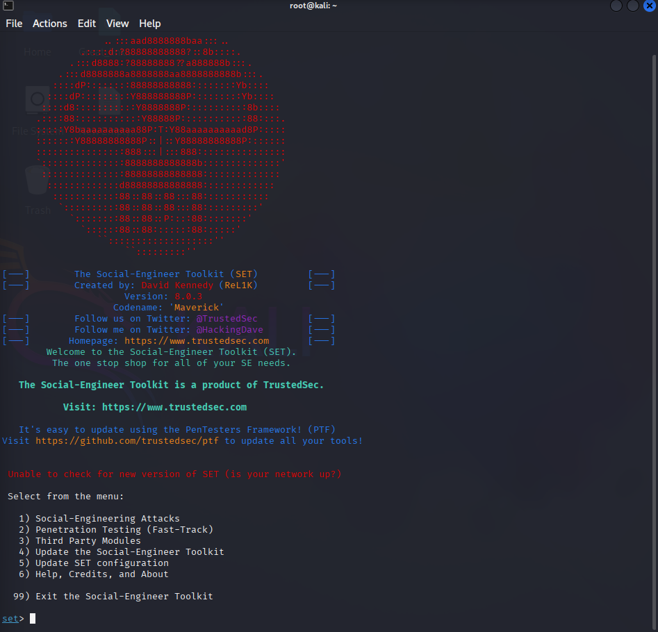
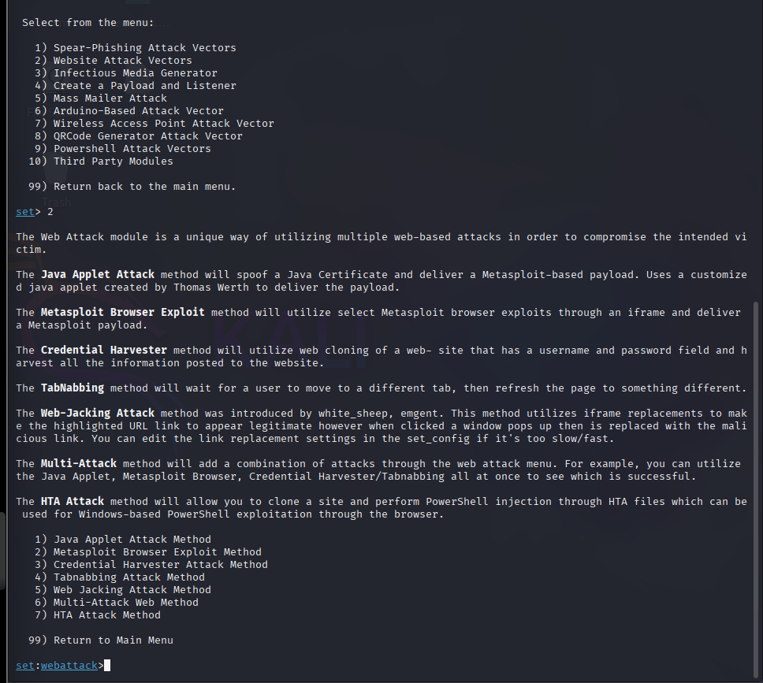
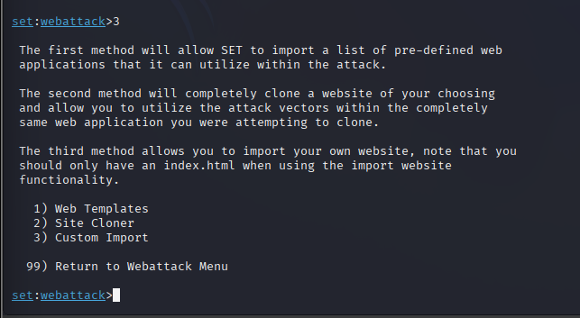
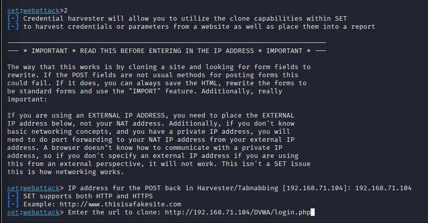
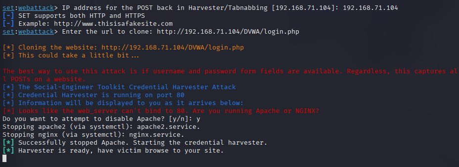
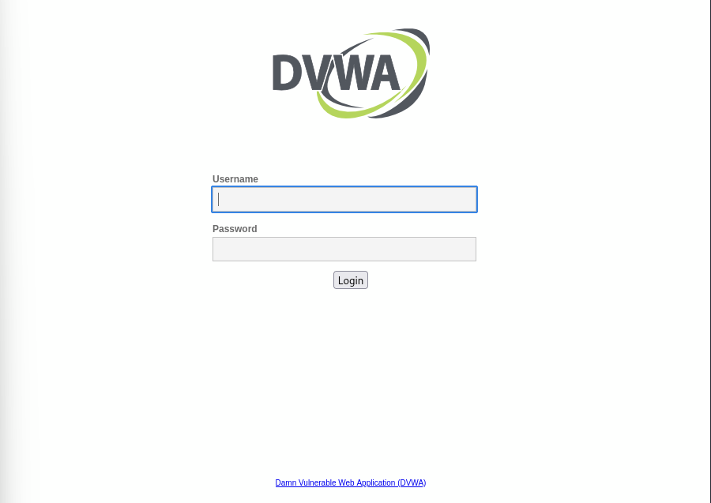
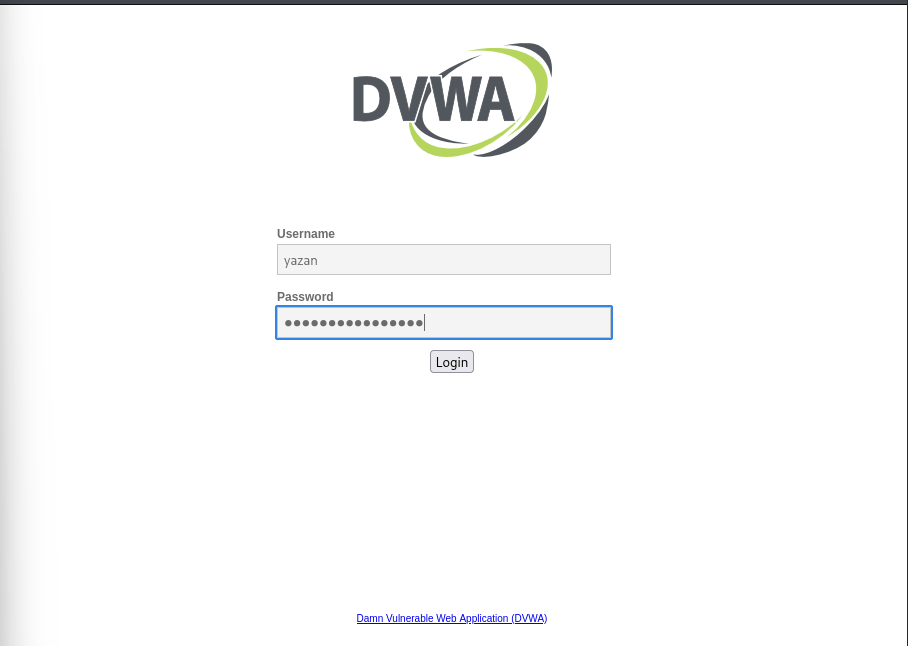
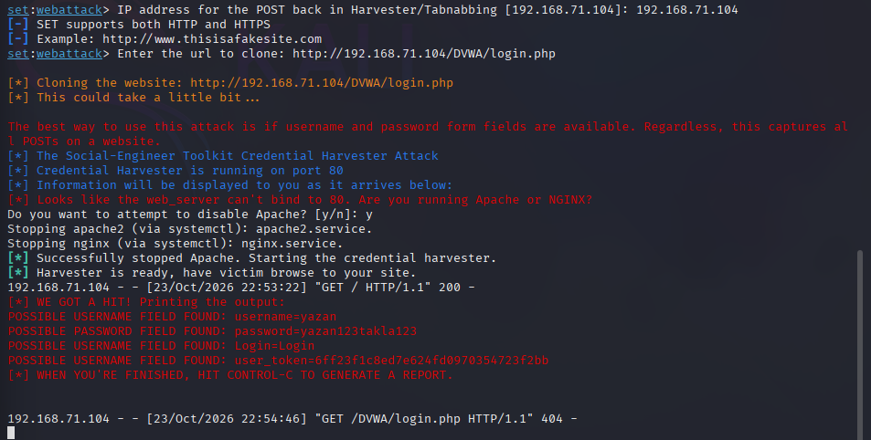

# DVWA Login Page Credential Harvesting Lab (SEToolkit)

## Overview

This repository documents a controlled, local lab exploring credential-capture risks using the Social-Engineer Toolkit (SEToolkit) and the Damn Vulnerable Web Application (DVWA).

In the exercise, a local DVWA login page was used as the page-cloning target. Test credentials were submitted in the lab, and the submitted values were reported to appear in the Kali Linux terminal.

This is a learning exercise about phishing risks and defensive controls. It is not evidence that a real account was compromised.

> **Safety note:** Use only systems you own or are explicitly authorized to test. The screenshots published in this repository must contain test data only. Do not publish real passwords, session tokens, cookies, or other secrets.

## Objectives

- Explore the relevant SEToolkit menus for a controlled credential-harvesting demonstration.
- Observe how a simulated login page can expose submitted test values.
- Document the lab setup and observed behavior.
- Identify defensive measures against credential phishing.

## Lab Environment

- **Operating system:** Kali Linux
- **Tool:** Social-Engineer Toolkit (SEToolkit), version shown in the screenshot
- **Test application:** DVWA
- **Target URL shown during setup:** `http://192.168.71.104/DVWA/login.php`
- **POST-back address shown during setup:** `192.168.71.104`
- **Scope:** Local lab exercise

The address above is documented from the lab screenshots. It describes the configured lab address; it does not independently prove that the virtual network was fully isolated.

## Methodology and Evidence

The following steps summarize the process documented by the available screenshots. Image filenames should match the files uploaded to the `evidence/` directory.

### 1. Launch SEToolkit

SEToolkit was launched in Kali Linux and its main menu was displayed.

### 2. Open Website Attack Vectors

The Website Attack Vectors menu was selected.

### 3. Select the site-cloning workflow

The Credential Harvester workflow and Site Cloner option were selected in the SEToolkit menus.

### 4. Configure the lab target

The POST-back address and local DVWA login URL were entered for the lab scenario.

### 5. Start the credential-harvesting listener

The screenshot shows SEToolkit attempting to use port 80, stopping conflicting local web services, and reporting that the harvester was ready.

### 6. Remaining lab screenshots

The remaining screenshots document subsequent stages of the exercise. Review each image before publishing and ensure that no real credentials, tokens, or unrelated sensitive data are visible.

## Observed Result

During the local exercise, test values entered into the simulated login page appeared in the Kali Linux terminal, according to the lab observation.

This demonstrates that submitted form values can be exposed to the operator of a credential-capture endpoint. The observation alone does **not** establish that the values were valid, that DVWA authentication was bypassed, or that any real account or external system was compromised.

## Security Analysis

A cloned or deceptive login page can trick a user into submitting information to an unintended endpoint. Depending on the implementation and environment, submitted form fields may be visible to the endpoint receiving the request.

Potential risks include credential disclosure and account compromise if valid credentials are captured and reused.

## Defensive Recommendations

- Verify the domain and destination before entering credentials.
- Prefer phishing-resistant authentication, such as passkeys or FIDO2 security keys, where supported.
- Use a password manager to help identify domain mismatches.
- Train users to recognize suspicious login prompts and report phishing attempts.
- Apply appropriate monitoring and reporting processes for suspected credential-phishing pages.
- For web applications you administer, review authentication design, transport security, and relevant security headers. A Content Security Policy can help constrain form submissions on the site where it is configured, but it does not by itself stop an attacker from operating a separate lookalike site.

## Lessons Learned

This lab provided practical exposure to SEToolkit's website attack menu and demonstrated the risk that simulated login pages can pose to submitted credentials. It also reinforced the importance of careful evidence handling and defensive authentication practices.

## Scope and Ethics

This repository documents a learning exercise in a local, authorized environment. Do not use these techniques against real services or people without explicit authorization. Only sanitized screenshots containing test data should be published.

## Disclaimer

This is an educational lab report, not a professional penetration-test report. Conclusions are limited to the steps and observations documented here.
